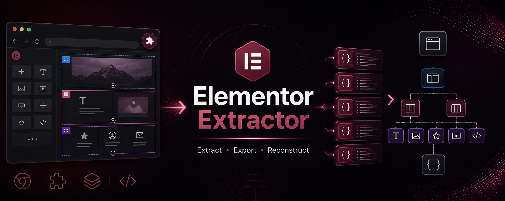

<p align="center">
  
  <br />
  
</p>

<h1 align="center">Elementor Extractor</h1>

<p align="center">
  Extensão do Chrome (Manifest V3) que lê páginas WordPress feitas com Elementor e reconstrói a estrutura delas em um JSON pronto para importar no Elementor.
  <br />
  <a href="README.md">English / فارسی</a> · <strong>Português (Brasil)</strong>
</p>

---

## 📋 Visão geral

O **Elementor Extractor** escaneia uma página feita com o construtor Elementor e reconstrói a estrutura dela a partir do DOM ao vivo. Ele gera dois arquivos JSON:

| Arquivo | Para que serve |
|---------|----------------|
| **`elementor-import-template-*.json`** | Template limpo, pronto para importar em `Elementor → Templates → Importar` |
| **`elementor-extract-report-*.json`** | Relatório técnico completo com todos os elementos, recursos, configurações e estatísticas extraídos |

É útil para desenvolvedores, designers e quem precisa arquivar, migrar ou analisar páginas feitas com Elementor.

---

## ✨ Recursos

- **Detecção do Elementor** por marcadores no DOM, classes CSS, scripts, folhas de estilo e meta tags
- **Estrutura completa**: seções, colunas, contêineres (`e-con`) e widgets, mantendo a hierarquia
- **Mais de 30 tipos de widget** reconhecidos (`heading`, `text-editor`, `image`, `button`, `video`, `icon-list`, `tabs`, `accordion`, `counter`, `testimonial` e outros). Widgets desconhecidos têm o tipo deduzido pelo HTML
- **Recursos da página**: links, imagens, formulários (só a estrutura, nunca o que foi digitado), vídeos, imagens de fundo, variáveis CSS do Elementor, folhas de estilo e scripts
- **Reconstrução inteligente**: IDs estáveis, widgets soltos embrulhados em seções válidas e HTML limpo (sem `script`, `style` e `meta`)
- **Selecionar seção**: escolha só uma parte da página para exportar (veja abaixo)
- **Prévia da estrutura**: árvore de seções → colunas → widgets no popup, ao lado do JSON
- **Interface traduzida**: segue o idioma do navegador (português do Brasil, inglês ou persa)

---

## 🔒 Segurança e privacidade

- **Permissões mínimas**: a extensão só acessa a aba em que você clica nela (`activeTab`). Não há permissão para todos os sites.
- **Escaneamento isolado**: o `scanner.js` e o `picker.js` rodam no ambiente isolado da extensão, então os scripts do site não conseguem interferir neles. Só uma leitura pequena da configuração do Elementor roda no contexto da página.
- **Dados sensíveis removidos**: nonces, tokens e valores parecidos (inclusive `?_wpnonce=` em links) são trocados por `[redacted]` nos dois arquivos.
- **Nada sai do seu computador**: a extensão não faz nenhuma requisição de rede. O resultado só vai para um download local ou para a área de transferência.

---

## 🔧 Instalação

1. **Baixe** ou clone este repositório:
   ```bash
   git clone https://github.com/Hordekiller/ElementCopy.git
   ```
2. No Chrome, abra `chrome://extensions`
3. Ative o **Modo do desenvolvedor** (canto superior direito)
4. Clique em **Carregar sem compactação** e escolha a pasta da extensão

---

## 🚀 Como usar

1. **Abra** uma página WordPress feita com Elementor
2. **Clique** no ícone do Elementor Extractor na barra do navegador
3. **Clique** em **Escanear página atual**
4. Confira a estrutura (ou a aba JSON) no popup
5. Escolha o que fazer:

| Botão | O que faz |
|-------|-----------|
| **Baixar para o Elementor** | Baixa o JSON do template para importar no Elementor |
| **Baixar relatório** | Baixa o relatório técnico completo em JSON |
| **Copiar resultado** | Copia o JSON do template para a área de transferência |

### Exportar só uma seção

1. Clique em **Selecionar seção**. O popup fecha.
2. Passe o mouse sobre a página: a parte sob o cursor fica destacada.
3. Use **↑** para subir para o elemento pai, **↓** para voltar e **Esc** para cancelar. Durante a seleção, cliques em links não abrem a página.
4. Clique na parte desejada.
5. Abra a extensão de novo e clique em **Escanear seleção**. Para voltar à página inteira, clique em **Limpar**.

Se você escolher algo que não é do Elementor, a extensão gera um widget HTML com o conteúdo.

### Importar no Elementor

1. Baixe o arquivo **`elementor-import-template-*.json`**
2. No painel do WordPress, vá em **Templates → Templates salvos**
3. Clique em **Importar template**
4. Escolha o arquivo JSON baixado
5. O template é importado com todas as seções, colunas e widgets reconhecidos

> **⚠️ Importante:** use só o arquivo `elementor-import-template-*.json` para importar. O `elementor-extract-report-*.json` serve apenas como referência; importá-lo faz o Elementor mostrar o erro "Invalid Content In File".

---

## ⚠️ Limitações

- **Só o que está no DOM**: conteúdo carregado depois (lazy load, rolagem, cliques) precisa estar visível antes de escanear
- **Sem acesso ao banco de dados**: configurações internas do Elementor (tags dinâmicas, condições avançadas) não aparecem no front-end
- **Widgets Pro e de terceiros**: são convertidos para o equivalente genérico mais próximo, e algumas configurações podem se perder
- **CSS do tema**: o CSS específico do tema ou gerado dinamicamente não é reconstruído
- **Imagens**: continuam apontando para as URLs originais; não são enviadas para a biblioteca de mídia do seu WordPress

---

## 🤝 Uso responsável

Use a extensão em sites seus, em sites cujo dono autorizou ou como referência de estudo. Textos, imagens e design de terceiros podem ser protegidos por direitos autorais.

---

## 📄 Licença

Este projeto está sob a **Licença MIT**. Veja o arquivo [LICENSE](LICENSE).
